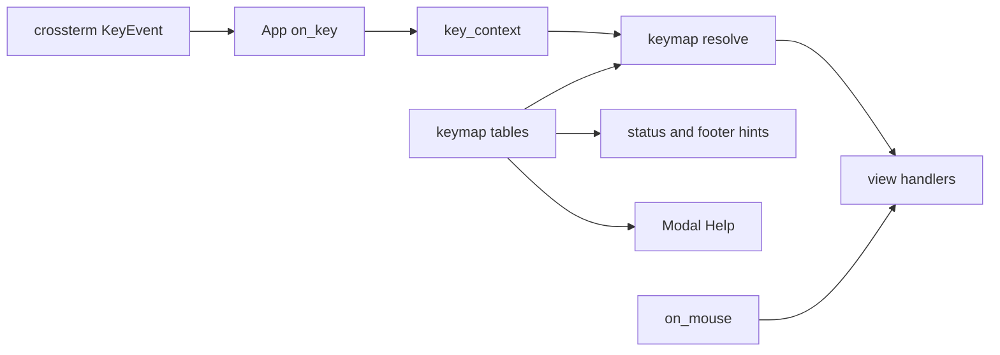

# Requirements

### Overview & Goals
Make `rune-tui`'s shortcuts consistent and predictable across every view. Move all key definitions into one keymap that both **dispatches** keys and **generates** footer hints and a new contextual help screen, so docs and behaviour can't drift apart. All existing features stay.

### Scope
**In scope:** chat list, compose box, message selection/actions, media viewer, profile page, and every overlay (menu, confirm, info, form, picker, attach, stickers, settings). Also status bar and footer hints, a new help overlay, terminal keyboard-protocol setup, and the doc comment at the top of `rune-tui.rs`.

**Out of scope:** user-configurable keymaps or a config file, mouse handling (beyond reusing the new commands), and library code.

### User Stories
- As a user, I navigate every list with arrow keys, or `j`/`k` if I prefer Vim, and `Enter`/`Esc` always mean confirm/open and back/close/cancel.
- As a user, I press `m` to get the menu for whatever is selected.
- As a user, I press `?` (or `F1` while typing) to see exactly the shortcuts that work in the current view.
- As a user, I can type any message (including `?`, `m`, `j`, `k`) without it being taken as a shortcut.

### Functional Requirements
1. **Navigation:** arrows are the primary keys everywhere. `j`/`k` (and `h`/`l` where horizontal) are aliases in non-typing contexts: chat list, messages, menu, info, profile, **settings (new)**, stickers, viewer.
2. **Enter / Esc:** `Enter` confirms/opens in every context and `Esc` goes back/closes/cancels in every context. Existing extras stay: `Space` for select/toggle, `y`/`n` in confirm, `1`–`9` in menus.
3. **Menus (`m`):** chat list → chat menu, selected message → message menu, media viewer → menu of the viewed message (**new**). `Ctrl+G` (chat menu) and `Ctrl+O` (compose menu) stay for use while typing.
4. **Settings:** `Ctrl+,` opens settings from any main view. `Ctrl+S` and `S` (chat list) stay as fallbacks for terminals that can't report `Ctrl+,`.
5. **Quit:** `Ctrl+C` is the only quit key. **Every plain `q` binding is removed** (chat-list quit and the close alias in viewer, profile, menu, confirm, info, settings and stickers). The attach picker's "original quality" toggle moves from `q` to `o`.
6. **Typing is never intercepted:** in compose, form fields, the people-picker filter and the attach filter, printable characters go into the text, except the people-picker `Space` selection toggle and the existing attach-picker `.` (show hidden files) and `~` (go home) shortcuts when the filter is empty. Only non-printing keys, `Ctrl`-chords, `F1`, `Space` selection, and those two explicitly preserved empty-filter shortcuts act as shortcuts there. In message selection, any unbound letter still starts typing (current behaviour).
7. **Help screen:** `?` opens a help overlay in every non-typing context, and `F1` opens it in every context. It lists the bindings for the view that was active (plus global ones), scrolls with ↑↓/`j`/`k`/PgUp/PgDn, and closes with `Esc`/`Enter`/`?`/`F1`, restoring any overlay that was open underneath.
8. **Generated hints:** the status bar hint and every overlay's bottom-border hint come from the keymap (only bindings flagged for the hint, plus `? help` outside typing contexts or `F1 help` in typing contexts). The hand-written strings are deleted.
9. **Preserved:** all other current shortcuts keep working (Tab, PgUp/PgDn, ←/→ focus, `r e x i u g v p s o + - a d n P`, sticker `[ ]`, attach `f . ~`, settings `1`–`5`, etc.).

### Non-Functional Requirements
- `cargo clippy --all-targets --features tui` stays at zero warnings, and `cargo fmt` is clean (max width 110).
- No behaviour change on terminals without the kitty keyboard protocol, apart from `Ctrl+,` being unavailable there (the `Ctrl+S` fallback covers it).

# Technical Design

### Current Implementation
- `App::on_key` (`src/bin/rune-tui.rs` ~3048) dispatches in this order: Ctrl+C → `modal_key` → `profile_key` → Ctrl+O/G/S/P → viewer `match` → global PgUp/PgDn/Tab/←/→ → `Focus::{Chats, Input, Messages}` matches.
- Overlays have their own raw `KeyCode` matches: `modal.rs::modal_key` (Menu/Confirm/Info/Form/Pick), `attach.rs::attach_key`, `stickers.rs::stickers_key`, `settings.rs::settings_key`, `profile.rs::profile_key`.
- Hints are hand-written strings in about 15 places: the status-bar `hint` match in `draw` (~3466), `draw_viewer` `title_bottom` (~3543), `profile.rs` ~505, `attach.rs` ~470, `settings.rs` ~541, `stickers.rs` ~239, `modal.rs` ~875/946, plus the `help` strings passed when menus/forms are built.
- The terminal never enables keyboard enhancement (`main` ~4330), so `Ctrl+,` is indistinguishable from other input today.
- Mouse code sends synthetic `KeyEvent`s into `modal_key`, `profile_key` and others. That keeps working because handlers still receive `KeyEvent`/`KeyCode` and resolve them internally.

### Key Decisions
1. **The table resolves commands** (user choice): handlers match on `keymap::resolve(ctx, &k) -> Option<Cmd>` instead of `KeyCode`. Help and hints are generated from the same static tables, so a key can't be documented without being bound, or the other way round.
2. **Minimal structural change:** handler functions, `Modal`, `Focus` and the dispatch order stay. Only the key-matching inside each handler is swapped. No trait-based dispatch.
3. **Text-entry contexts bind only non-printing keys.** If `resolve` returns `None` for a plain char, the handler inserts it, which is what guarantees typing isn't intercepted.
4. **Kitty keyboard protocol:** when `crossterm::terminal::supports_keyboard_enhancement()` is true, push `KeyboardEnhancementFlags::DISAMBIGUATE_ESCAPE_CODES` after the image-protocol query and pop it on exit. `Ctrl+S` stays as the settings fallback.
5. **Help is a new `Modal::Help`** that remembers the context and the overlay underneath, so closing it restores that overlay. The viewer and profile aren't modals, so they simply stay underneath.
6. **`q` removed everywhere.** Attach "original quality" is rebound to `o`.

### Data Models / Contracts
New file `src/bin/rune-tui/keymap.rs` (registered with `#[path = "rune-tui/keymap.rs"] mod keymap;`):
```rust
#[derive(Clone, Copy, PartialEq, Eq, Debug)]
pub enum Ctx { ChatList, ChatListInvite, Compose, ComposeReply, Messages,
  ViewerStill, ViewerAnimated, ViewerPlayable, Profile, ProfileMine,
  Menu, Confirm, Info, Form, Pick, AttachBrowse, AttachChosen, AttachCover,
  Stickers, Settings, Help }

#[derive(Clone, Copy, PartialEq, Eq, Debug)]
pub enum Cmd { Up, Down, Left, Right, PageUp, PageDown, Home, End,
  Confirm, Back, Toggle, Menu, Help, Settings, Quit, SwitchFocus,
  ComposeMenu, ChatMenu, ProfileOfChat, MyProfile, Profile, NewGroup, Accept, Decline,
  Reply, React, Unsend, ReadBy, OpenLink, ViewStill, GotoQuoted, Save, OpenExternal,
  ThumbBigger, ThumbSmaller, PlayPause, Yes, No, Digit(u8), NextTab, PrevTab,
  ProfileChat, ProfilePhoto, ProfileCover, ChangeCover,
  AsFile, OriginalQuality, ShowHidden, HomeDir, ParentDir }

pub struct Key { pub code: KeyCode, pub mods: KeyModifiers }
pub struct Binding { pub keys: &'static [Key], pub cmd: Cmd,
  pub help: &'static str, pub hint: bool }

pub const GLOBAL: &[Binding];               // Ctrl+C, Ctrl+, / Ctrl+S, F1, Ctrl+P, Ctrl+O, Ctrl+G
pub fn bindings(ctx: Ctx) -> &'static [Binding];
pub fn resolve(ctx: Ctx, k: &KeyEvent) -> Option<Cmd>; // ctx table first, then GLOBAL where allowed;
                                            // SHIFT ignored for Char keys ('?', 'S', 'P')
pub fn is_typing(ctx: Ctx) -> bool;           // Compose*, Form, Pick, AttachBrowse
pub fn hint(ctx: Ctx) -> String;             // "↑↓ select · Enter open · m menu · ? help"
pub fn help_lines(ctx: Ctx) -> Vec<(String, &'static str)>; // ("↑/k", "previous chat")
```
In `modal.rs`: `Modal::Help { ctx: Ctx, under: Option<Box<Modal>>, scroll: usize }`.
In `rune-tui.rs`: `fn key_context(&self) -> Ctx`, which mirrors the `on_key` order (modal kind → profile → viewer → focus) and reuses `viewer_plays()`, `viewer_animates()`, `selected_invited()` and `replying`.

### Proposed Changes
- **`on_key`:** compute `ctx = self.key_context()` and `cmd = keymap::resolve(ctx, &k)`. Handle `Quit`, `Help` (`?` only where `!is_typing(ctx)`; `F1` always) and `Settings` globally, then call the existing per-view branch with `cmd`. In `Messages`, `None` + `Char(c)` still starts typing. In `Compose`, `None` + `Char(c)` pushes `c`.
- **Viewer:** `m` → `message_menu()` of the viewed message. Enter keeps its current behaviour (play if playable, else close).
- **Overlays:** `modal_key`, `attach_key`, `stickers_key`, `settings_key` and `profile_key` resolve against their context. Settings gains `j`/`k`. All `q` arms are deleted, and attach's `OriginalQuality` is bound to `o`.
- **Hints:** `draw` (status bar), `draw_viewer`, `draw_profile`, `draw_attach`, `draw_settings`, `draw_stickers` and `draw_modal` all use `keymap::hint(ctx)`. Info keeps its scroll counter as a prefix.
- **Help overlay:** drawn in `modal.rs` like `Info` (popup with two columns, key and description), scrollable.
- **Terminal setup:** `main` adds `PushKeyboardEnhancementFlags` / `PopKeyboardEnhancementFlags`.
- **Docs:** update the `//! Keys:` doc comment at the top of `rune-tui.rs`.

### Architecture Diagram


### Risks
- **Shift reporting:** with the kitty protocol, `?`/`S`/`P` may arrive with `SHIFT` set, so `resolve` ignores SHIFT for `Char` keys.
- **Context precedence drift:** `key_context` must follow the same order as `on_key`. Covered by unit tests per view.
- **Muscle memory:** removing `q` is intentional (user decision). The help screen and hints make `Esc`/`Ctrl+C` visible.
- **Synthetic mouse key events** still go through `resolve`, so mapping Enter/Space/Up/Down must stay bound in Menu/Pick/Attach/Settings.

# Testing

### Validation Approach
Use the existing test harness in `src/bin/rune-tui.rs` (`app()` + `key(&mut a, KeyCode)`) plus new pure unit tests in `keymap.rs`. Run `cargo test --features tui`, `cargo clippy --all-targets --features tui` (zero warnings) and `cargo fmt --check`.

### Key Scenarios
- Every `Ctx` table: no duplicate key within ctx + GLOBAL, every binding has non-empty help, and `hint(ctx)` ends with the context-appropriate `? help` or `F1 help`.
- Text contexts (`Compose`, `ComposeReply`, `Form`, `Pick`, `AttachBrowse`): `resolve` returns `None` for every printable ASCII char, except `Space` in `Pick` for selection and `.`/`~` in `AttachBrowse` for the empty-filter shortcuts.
- Typing `?mjkq` in compose appends exactly those characters. `F1` there opens `Modal::Help` with `ctx == Compose`.
- `?` in chat list opens help for `ChatList`. `Esc` closes it. With a menu open, `?` → help → `Esc` restores the same menu with the same selection.
- `Ctrl+,` and `Ctrl+S` open settings, and `S` in the chat list still does. `j`/`k` move between settings rows.
- `m` opens the chat menu (chat list), the message menu (messages) and the message menu (viewer).
- `Ctrl+C` quits from any context, including inside a form.

### Edge Cases
- `q` in the chat list does **not** quit, and `q` in menu/confirm/info/settings/stickers/viewer/profile does nothing (overlay stays open).
- Attach chosen image: `o` toggles original quality, `f` still toggles send-as-file.
- `?` and `S` delivered with `KeyModifiers::SHIFT` resolve the same as without.
- Existing tests (`message_keys_and_pasted_files`, the menu/form flows around lines 4557–4973) keep passing. Any that used `q` get updated to use `Esc`.

### Test Changes
- Add `#[cfg(test)] mod tests` in `keymap.rs` (table invariants, resolve, shift normalisation).
- Add app-level tests in `rune-tui.rs` `mod tests` for help open/close/restore, typing pass-through, settings shortcuts, `m` in each context and removed `q`.

# Delivery Steps

### ✓ Step 1: Create keymap module and enable kitty keyboard protocol
A central `keymap.rs` defines every context, command and binding, with tests, and the terminal can report `Ctrl+,`.

- Add `src/bin/rune-tui/keymap.rs` with `Ctx`, `Cmd`, `Key`, `Binding`, `GLOBAL`, `bindings()`, `resolve()` (SHIFT-insensitive for chars), `is_typing()`, `hint()` and `help_lines()`.
- Fill tables for all contexts with today's keys, minus every `q`, plus the new keys: `Ctrl+,`, `?`, `F1`, `j`/`k` in settings, `m` in viewer, `o` for original quality.
- Register the module in `rune-tui.rs` with the `#[path]` pattern.
- In `main`: push `DISAMBIGUATE_ESCAPE_CODES` when `supports_keyboard_enhancement()` is true (after the picker query), and pop it on exit.
- Unit tests: no duplicates, help present, printable chars unbound in typing contexts, shift normalisation, and `Ctrl+,`/`Ctrl+S` → `Settings`.

### ✓ Step 2: Route main-view keys through the keymap
Chat list, compose, message actions and the media viewer dispatch via `resolve`, and the status bar hint is generated.

- Add `App::key_context()`, mirroring `on_key` precedence.
- Rewrite `on_key` (global, viewer, `Focus::Chats/Input/Messages` branches) to match on `Cmd`, keeping unbound-char typing behaviour.
- Handle `Quit`/`Settings`/`ChatMenu`/`ComposeMenu`/`ProfileOfChat` globally, and add `m` → message menu in the viewer.
- Remove chat-list `q` quit and viewer `q` close.
- Replace the status-bar `hint` match in `draw` and the `draw_viewer` `title_bottom` with `keymap::hint(ctx)`.
- Add or update app tests: typing `?mjkq` in compose, `m` per context, `q` no longer quits, settings shortcuts.

### ✓ Step 3: Route overlay and profile keys through the keymap
Menus, confirm, info, forms, pickers, attach, stickers, settings and the profile page use the keymap, and their footers are generated.

- Convert `modal.rs::modal_key` (Menu/Confirm/Info/Form/Pick), `attach.rs::attach_key`, `stickers.rs::stickers_key`, `settings.rs::settings_key` and `profile.rs::profile_key` to `resolve` with their `Ctx`.
- Remove every `q` arm, add `j`/`k` to settings, and move attach original quality to `o`.
- Keep mouse paths working (synthetic Enter/Space/Up/Down still resolve).
- Replace the hand-written `title_bottom`/`help` strings in `draw_modal`, `draw_attach`, `draw_stickers`, `draw_settings` and `draw_profile` with `keymap::hint(ctx)`; Info keeps its scroll counter.
- Update existing modal/attach/sticker tests that relied on `q`, and add tests for settings `j`/`k` and attach `o`.

### ✓ Step 4: Add contextual help overlay and update docs
`?` (outside typing) and `F1` (everywhere) open a scrollable help screen listing the current view's shortcuts.

- Add `Modal::Help { ctx, under, scroll }` in `modal.rs`.
- Draw it like `Info`, with two columns from `keymap::help_lines(ctx)` plus global bindings.
- Open it from `on_key` and `modal_key`, capturing the active ctx and any modal underneath. Close it with `Esc`/`Enter`/`?`/`F1`, restoring the previous modal. Scroll with ↑↓/`j`/`k`/PgUp/PgDn/Home/End.
- Tests: help from the chat list, `F1` from compose, help over a menu restores the menu, `?` still types in compose.
- Update the `//! Keys:` doc comment at the top of `rune-tui.rs`.
- Run `cargo test --features tui`, `cargo clippy --all-targets --features tui` and `cargo fmt`.